<!--
  Erbil's GitHub Profile: cyberpunk RPG operator sheet (HTML UI)
  GitHub sets table { width: max-content } and img { max-width: 100% }.
  Use assets/spacer-900.png as a real 900x1 purple line so max-content stretches.
  Palette: void #0A0612 / panel #160B24 / purple #BF5AF2 / neon yellow #FFE566
  Progress bars: assets/bars/*.svg (SMIL fill + tip glow; Camo-safe)
  Signature: assets/operator-portrait.svg · prefer repo assets over host spam
-->

  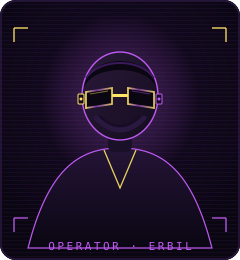

 

  

 

  
  
  
  

 

  
   
  <a href="https://github.com/erbilnas/baklavue">baklavue</a> · <a href="https://baklavue.erbilnas.com">baklavue.erbilnas.com</a> · A Vue 3 UI kit for Trendyol Baklava design system components

  

<table>
  <tr>
    <td colspan="2" align="center">
      
      <h2>🔌 Jack points</h2>
      uplinks
    </td>
  </tr>
  <tr>
    <td width="50%" align="center" valign="top">
      <h3>📡 Comms</h3>
      
        X / Twitter
    </td>
    <td width="50%" align="center" valign="top">
      <h3>🪪 Dossier</h3>
      
        LinkedIn
    </td>
  </tr>
  <tr>
    <td width="50%" align="center" valign="top">
      <h3>🏙 Safehouse</h3>
      
        my site
    </td>
    <td width="50%" align="center" valign="top">
      <h3>💾 Vault</h3>
      
        repos
    </td>
  </tr>
</table>

  

<table>
  <tr>
    <td colspan="2" align="center">
      
      <h2>📶 Signal metrics</h2>
      live network reputation
    </td>
  </tr>
  <tr>
    <td width="50%" align="center" valign="top">
      <h3>Fame</h3>
        
      
        stars
    </td>
    <td width="50%" align="center" valign="top">
      <h3>Crew</h3>
        
      
        followers
    </td>
  </tr>
  <tr>
    <td width="50%" align="center" valign="top">
      <h3>Scans</h3>
        
      
        profile views
    </td>
    <td width="50%" align="center" valign="top">
      <h3>Builds</h3>
        
      
        public repos
    </td>
  </tr>
</table>

  

<table>
  <tr>
    <td align="center">
      
      <h2>🧬 Operator dossier</h2>
      <table>
        <tr><td><b>Callsign</b></td><td>Erbil</td></tr>
        <tr><td><b>Class</b></td><td>Senior Software Engineer</td></tr>
        <tr><td><b>Spec</b></td><td>Frontend Engineering</td></tr>
        <tr><td><b>Corp</b></td><td>Uber Eats</td></tr>
        <tr><td><b>Node</b></td><td>Istanbul, Turkey</td></tr>
        <tr><td><b>Alignment</b></td><td>Chaotic Good</td></tr>
        <tr><td><b>Status</b></td><td>Online. Still learning.</td></tr>
        <tr><td><b>HP</b></td><td> caffeinated</td></tr>
        <tr><td><b>MP</b></td><td> deep focus buffer</td></tr>
      </table>
    </td>
  </tr>
</table>

  

<table>
  <tr>
    <td align="center">
      
      <h2>📜 Active contract</h2>
      
        
      
I work on Uber Eats: food and grocery delivery for millions.

      
<b>Open channels</b>

      <ul>
        <li>Happy to talk software engineering, design systems, performance</li>
        <li>Up for code reviews and architecture chats</li>
        <li>Things aren't always <code>#000000</code> and <code>#FFFFFF</code></li>
      </ul>
    </td>
  </tr>
</table>

  

<table>
  <tr>
    <td colspan="2" align="center">
      
      <h2>⚙️ Core mods</h2>
      wetware ratings · max 20
    </td>
  </tr>
  <tr>
    <td width="50%" align="center" valign="top">
      <h3>CPU · 18</h3>
        architecture, tradeoffs, the big picture
    </td>
    <td width="50%" align="center" valign="top">
      <h3>IFACE · 17</h3>
        Vue, TypeScript, pixels that behave
    </td>
  </tr>
  <tr>
    <td width="50%" align="center" valign="top">
      <h3>SCAN · 16</h3>
        bugs, edge cases, reading the room
    </td>
    <td width="50%" align="center" valign="top">
      <h3>BATTERY · 15</h3>
        late nights, long focus, still online
    </td>
  </tr>
  <tr>
    <td width="50%" align="center" valign="top">
      <h3>SIGNAL · 14</h3>
        clear notes, reviews, saying the quiet part
    </td>
    <td width="50%" align="center" valign="top">
      <h3>GLITCH · 13</h3>
        deploys that somehow land on time
    </td>
  </tr>
</table>

  

<table>
  <tr>
    <td align="center">
      
      <h2>🎒 Loadout</h2>
      tech from erbilnas.com
        
      
    </td>
  </tr>
</table>

  

<table>
  <tr>
    <td align="center">
      
      <h2>🚀 Active runs</h2>
      current builds · full width on mobile
        
    </td>
  </tr>
  <tr>
    <td align="center">
      
       
      now shipping · <a href="https://baklavue.erbilnas.com">baklavue.erbilnas.com</a>
        
    </td>
  </tr>
  <tr>
    <td align="center">
      
        
    </td>
  </tr>
  <tr>
    <td align="center">
      
        
    </td>
  </tr>
  <tr>
    <td align="center">
      
        
    </td>
  </tr>
  <tr>
    <td align="center">
      
       
      also live at <a href="https://erbilnas.com">erbilnas.com</a>
    </td>
  </tr>
</table>

  

<table>
  <tr>
    <td align="center">
      
      <h2>🗄 Archived runs</h2>
      older contracts still on the vault
        
    </td>
  </tr>
  <tr>
    <td align="center">
      
        
    </td>
  </tr>
  <tr>
    <td align="center">
      
        
    </td>
  </tr>
  <tr>
    <td align="center">
      
    </td>
  </tr>
</table>

  

<table>
  <tr>
    <td align="center">
      
      <h2>🧠 Neural log</h2>
      
        
    </td>
  </tr>
  <tr>
    <td>
      
Introducing myself is always awkward, so here's the short version. I'm a software engineer. I like learning, and I build things with zeros and ones. I'm 29, born and raised in Turkey.

      
Average height, a bit leaner than most. Short hair, beard. On sunny days I wear sunglasses because of an eye issue. Sunlight and I are not friends.

      
I've been into computers, software, and video games since I was a kid. That trail led me into software engineering. I'm not the most social person, but if you catch me on something I care about, I talk a lot. ^_^

      
People have called me intelligent, sophisticated, cultured, dignified, gentle, calm, and humble. Nice words. I care more about doing what's right than about sounding like a good person.

      
Thanks for reading. Take care and stay safe.

    </td>
  </tr>
</table>

  

<table>
  <tr>
    <td align="center">
      
      <h2>📊 Telemetry</h2>
      combat record
        
      
        
      
        
      
    </td>
  </tr>
</table>

  

<table>
  <tr>
    <td align="center">
      
      <h2>🐍 Grid snake</h2>
      contribution hunter · local output branch
        
      <picture>
        <source media="(prefers-color-scheme: dark)" srcset="https://raw.githubusercontent.com/erbilnas/erbilnas/output/github-contribution-grid-snake-dark.svg" />
        <source media="(prefers-color-scheme: light)" srcset="https://raw.githubusercontent.com/erbilnas/erbilnas/output/github-contribution-grid-snake.svg" />
        
      </picture>
    </td>
  </tr>
</table>

  

  

