<!--
  Terminal console profile README.
  Generated SVGs: tools/profile/{fetch,render,readme}.py → assets/
  Palette: void #0A0612 · purple #BF5AF2 · yellow #FFE566
  Layout adapted from georgekobaidze/georgekobaidze (MIT)
-->

<a href="https://x.com/erbilnas"></a><a href="https://www.linkedin.com/in/erbilnas"></a><a href="https://erbilnas.com"></a><a href="https://github.com/erbilnas"></a>
<a href="https://baklavue.erbilnas.com"></a><a href="https://farkle.erbilnas.com"></a>
<a href="https://erbilnas.com"></a><a href="https://skills.erbilnas.com"></a>
<a href="https://conceptnest.com.tr"></a><a href="https://sidequestvr.com/app/6529/spaceflash"></a>
<a href="https://www.glaze.app/app/dont-be-afk-2SXArO"></a><a href="https://www.raycast.com/erbilnas/read-my-screen"></a>
<a href="https://www.glaze.app/app/git-persona-l3UPlC"></a>

  Profile layout adapted from <a href="https://github.com/georgekobaidze/georgekobaidze">georgekobaidze</a> (MIT) by Giorgi Kobaidze.

