<!--
  Erbil's GitHub Profile: cyberpunk RPG operator sheet (HTML UI)
  GitHub sets table { width: max-content } and img { max-width: 100% }.
  Use assets/spacer-hud.svg (900px HUD rail) so max-content stretches.
  Palette: void #0A0612 / panel #160B24 / purple #BF5AF2 / neon yellow #FFE566
  Local assets: portrait, headers, bars, cards, now-shipping, footer, snake
-->

  

 

  

 

  
  
  
  

 

  <a href="https://github.com/erbilnas/baklavue">
    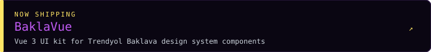
  </a>
   
  <a href="https://baklavue.erbilnas.com">baklavue.erbilnas.com</a>

  

<table>
  <tr>
    <td colspan="2" align="center">
      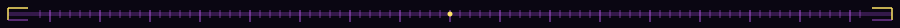
       
      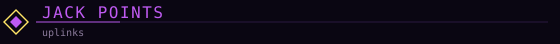
    </td>
  </tr>
  <tr>
    <td width="50%" align="center" valign="top">
      
    </td>
    <td width="50%" align="center" valign="top">
      
    </td>
  </tr>
  <tr>
    <td width="50%" align="center" valign="top">
      
    </td>
    <td width="50%" align="center" valign="top">
      
    </td>
  </tr>
</table>

  

<table>
  <tr>
    <td colspan="2" align="center">
      
       
      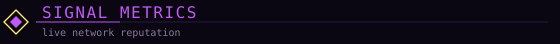
    </td>
  </tr>
  <tr>
    <td width="50%" align="center" valign="top">
      
    </td>
    <td width="50%" align="center" valign="top">
      
    </td>
  </tr>
  <tr>
    <td width="50%" align="center" valign="top">
      
    </td>
    <td width="50%" align="center" valign="top">
      
    </td>
  </tr>
</table>

  

<table>
  <tr>
    <td align="center">
      
       
      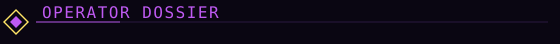
      <table>
        <tr><td><b>Callsign</b></td><td>Erbil</td></tr>
        <tr><td><b>Class</b></td><td>Senior Software Engineer</td></tr>
        <tr><td><b>Spec</b></td><td>Frontend Engineering</td></tr>
        <tr><td><b>Corp</b></td><td>Uber</td></tr>
        <tr><td><b>Node</b></td><td>Istanbul, Turkey</td></tr>
        <tr><td><b>Alignment</b></td><td>Chaotic Good</td></tr>
        <tr><td><b>Status</b></td><td>Online. Still learning.</td></tr>
        <tr><td><b>HP</b></td><td> caffeinated</td></tr>
        <tr><td><b>MP</b></td><td> deep focus buffer</td></tr>
      </table>
    </td>
  </tr>
</table>

  

<table>
  <tr>
    <td align="center">
      
       
      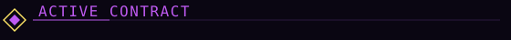
        
      
        
      

        
I work on Uber Eats: food and grocery delivery for millions.

        
<b>Open channels</b>

        <ul>
          <li>Happy to talk software engineering, design systems, performance</li>
          <li>Up for code reviews and architecture chats</li>
          <li>Things aren't always <code>#000000</code> and <code>#FFFFFF</code></li>
        </ul>
      

    </td>
  </tr>
</table>

  

<table>
  <tr>
    <td colspan="2" align="center">
      
       
      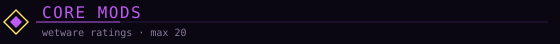
    </td>
  </tr>
  <tr>
    <td width="50%" align="center" valign="top">
      <h3>CPU</h3>
        architecture, tradeoffs, the big picture
    </td>
    <td width="50%" align="center" valign="top">
      <h3>IFACE</h3>
        Vue, TypeScript, pixels that behave
    </td>
  </tr>
  <tr>
    <td width="50%" align="center" valign="top">
      <h3>SCAN</h3>
        bugs, edge cases, reading the room
    </td>
    <td width="50%" align="center" valign="top">
      <h3>BATTERY</h3>
        late nights, long focus, still online
    </td>
  </tr>
  <tr>
    <td width="50%" align="center" valign="top">
      <h3>SIGNAL</h3>
        clear notes, reviews, saying the quiet part
    </td>
    <td width="50%" align="center" valign="top">
      <h3>GLITCH</h3>
        deploys that somehow land on time
    </td>
  </tr>
</table>

  

<table>
  <tr>
    <td align="center">
      
       
      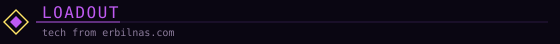
        
      
    </td>
  </tr>
</table>

  

<table>
  <tr>
    <td align="center">
      
       
      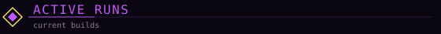
        
    </td>
  </tr>
  <tr>
    <td align="center">
      <a href="https://github.com/erbilnas/baklavue">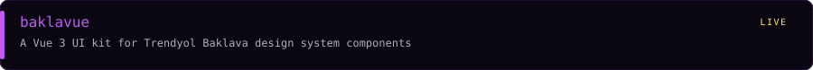</a>
       
      
      
        
    </td>
  </tr>
  <tr>
    <td align="center">
      <a href="https://github.com/erbilnas/farkle">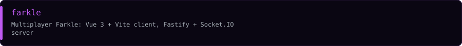</a>
       
      
      
        
    </td>
  </tr>
  <tr>
    <td align="center">
      <a href="https://github.com/erbilnas/portfolio">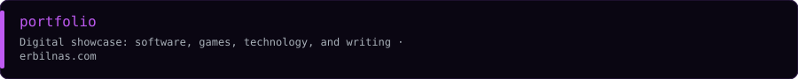</a>
       
      
      
        
    </td>
  </tr>
  <tr>
    <td align="center">
      <a href="https://github.com/erbilnas/skills">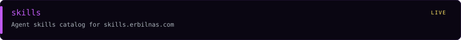</a>
       
      
      
        
    </td>
  </tr>
  <tr>
    <td align="center">
      <a href="https://github.com/erbilnas/nest-concept-web">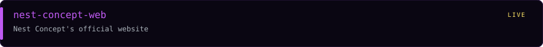</a>
       
      
      
        
    </td>
  </tr>
  <tr>
    <td align="center">
      <a href="https://github.com/erbilnas/spaceflash">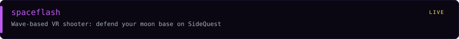</a>
       
      
      
        
    </td>
  </tr>
  <tr>
    <td align="center">
      <a href="https://github.com/erbilnas/dont-be-afk">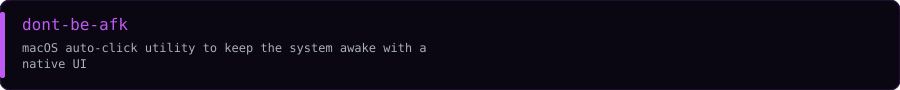</a>
       
      
      
        
    </td>
  </tr>
  <tr>
    <td align="center">
      <a href="https://github.com/erbilnas/read-my-screen">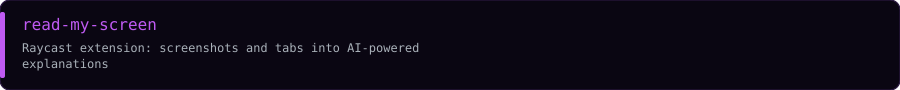</a>
       
      
        
    </td>
  </tr>
  <tr>
    <td align="center">
      <a href="https://github.com/erbilnas/git-persona">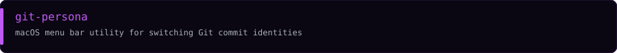</a>
       
      
    </td>
  </tr>
</table>

  

<table>
  <tr>
    <td align="center">
      
       
      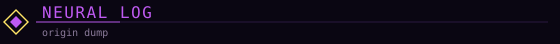
        
    </td>
  </tr>
  <tr>
    <td>
      
Introducing myself is always awkward, so here's the short version. I'm a software engineer. I like learning, and I build things with zeros and ones. I'm 29, born and raised in Turkey.

      
Average height, a bit leaner than most. Short hair, beard. On sunny days I wear sunglasses because of an eye issue. Sunlight and I are not friends.

      
I've been into computers, software, and video games since I was a kid. That trail led me into software engineering. I'm not the most social person, but if you catch me on something I care about, I talk a lot. ^_^

      
People have called me intelligent, sophisticated, cultured, dignified, gentle, calm, and humble. Nice words. I care more about doing what's right than about sounding like a good person.

      
Thanks for reading. Take care and stay safe.

    </td>
  </tr>
</table>

  

<table>
  <tr>
    <td align="center">
      
       
      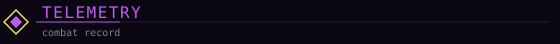
        
      
        
      
        
      
    </td>
  </tr>
</table>

  

<table>
  <tr>
    <td align="center">
      
       
      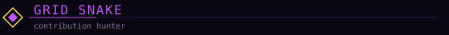
        
      <picture>
        <source media="(prefers-color-scheme: dark)" srcset="https://raw.githubusercontent.com/erbilnas/erbilnas/output/github-contribution-grid-snake-dark.svg" />
        <source media="(prefers-color-scheme: light)" srcset="https://raw.githubusercontent.com/erbilnas/erbilnas/output/github-contribution-grid-snake.svg" />
        
      </picture>
    </td>
  </tr>
</table>

  

  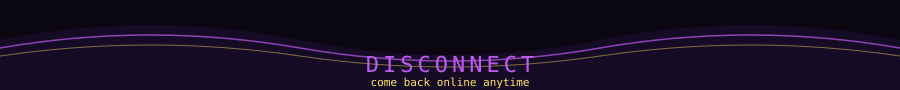

